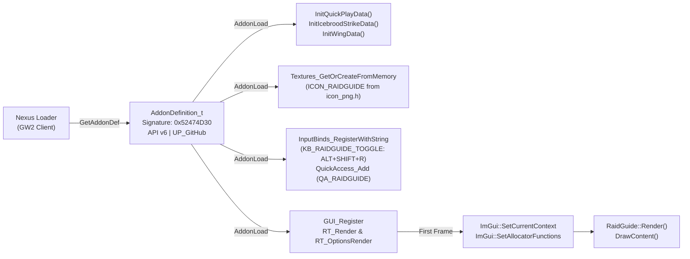

<p align="center">
  <a href="https://ko-fi.com/todd0042">
    
  </a>
</p>

---

# GW2 Raid Training Guide (Nexus Addon)

[](https://github.com/Todd0042/gw2-raid-guide/releases)
[-blue.svg)](https://github.com/Todd0042/gw2-raid-guide)
[](CMakeLists.txt)
[](imgui/imgui.h)
[](build.sh)
[](https://ko-fi.com/todd0042)

> **An in-game Guild Wars 2 Nexus overlay putting mechanics, telegraphs, callouts, common mistakes, and training walkthroughs for Raid Wings 1–8, Quick Play Raid Encounters, and Icebrood Saga Strike Missions one hotkey away — zero alt-tabbing required.**

<p align="center">
  
</p>

---

## Table of Contents

* **Part 1 — User Overview & Quick Start**
  * [What Is Raid Training Guide?](#what-is-raid-training-guide)
  * [Key Features & Encounter Coverage](#key-features--encounter-coverage)
  * [How It Works in Game](#how-it-works-in-game)
  * [Visual Preview](#visual-preview)
  * [Quick Start: Installation & Cross-Compile Build](#quick-start-installation--cross-compile-build)
  * [AI-Assisted Content Notice](#ai-assisted-content-notice)
* **Part 2 — Technical Architecture & Reference**
  * [1. Addon Lifecycle & Nexus Integration (`src/dllmain.cpp`, `Nexus.h`)](#1-addon-lifecycle--nexus-integration-srcdllmaincpp-nexush)
  * [2. ImGui Rendering, Color System & Shared Context (`src/ui/RaidGuide.cpp`, `src/ui/RaidGuide.h`)](#2-imgui-rendering-color-system--shared-context-srcuiraidguidecpp-srcuiraidguideh)
  * [3. Data Models & Static Compilation (`src/data/WingData.h`, `src/data/QuickPlayData.h`)](#3-data-models--static-compilation-srcdatawingdatah-srcdataquickplaydatah)
  * [4. JSON-to-C++ Code Generators & Embedded Assets (`gen_wingdata.py`, `gen_quickplaydata.py`, `gen_icebrooddata.py`, `gen_icon.py`)](#4-json-to-c-code-generators--embedded-assets-gen_wingdatapy-gen_quickplaydatapy-gen_icebrooddatapy-gen_iconpy)
  * [5. Cross-Compilation Build Pipeline & Static Runtime Linking (`CMakeLists.txt`, `build.sh`, `toolchain-mingw.cmake`)](#5-cross-compilation-build-pipeline--static-runtime-linking-cmakeliststxt-buildsh-toolchain-mingwcmake)
  * [6. Controls, Keybinds & Configuration](#6-controls-keybinds--configuration)
  * [7. Repository Structure](#7-repository-structure)
  * [8. Verification & Build Checks](#8-verification--build-checks)
  * [9. Third-Party Notices & Support](#9-third-party-notices--support)

---

# Part 1 — User Overview & Quick Start

## What Is Raid Training Guide?

**Raid Training Guide** (`RaidGuide.dll`) is a native C++17 addon for **[Guild Wars 2 Nexus](https://raidcore.gg/Nexus)** that embeds a structured, color-coded encounter reference directly inside the game client.

Instead of alt-tabbing to wikis or PDF cheat sheets between pulls, commanders, trainers, and raiders can toggle an organized tabbed overlay with a single keybind (`ALT+SHIFT+R` by default) or Nexus Quick Access icon to inspect boss mechanics, failure consequences, common squad mistakes, callouts, and recovery plans right over the game window.

---

## Key Features & Encounter Coverage

All encounter reference data is compiled directly into the DLL for instant, zero-latency offline access—no external web requests, API keys, or disk config files needed at runtime.

| Tab | Source Data | Coverage | Structured Sections |
| :--- | :--- | :--- | :--- |
| **Quick Play** | [QuickPlayRaids.json](QuickPlayRaids.json) | **8 encounters** (57 mechanics) across *Icebrood Saga*, *End of Dragons*, and *Secrets of the Obscure* | Overview, Goal, Mechanics (`Category`, `Description`, `How to Handle`, `If You Fail`), Common Mistakes, Callouts, Training Notes (`Pre-Pull`, `Phase Walkthrough`, `Recovery Plans`) |
| **Strike Missions** | [IcebroodStrikes.json](IcebroodStrikes.json) | **3 Icebrood Saga strikes** (15 mechanics): *Shiverpeaks Pass*, *Voice of the Fallen and Claw of the Fallen*, *Fraenir of Jormag* | Same structured overview, mechanic breakdown, callouts, and training notes format |
| **Wings 1–8** | [Wing1Training.json](Wing1Training.json) – [Wing8Training.json](Wing8Training.json) | **8 Wing tabs, 29 bosses** (157 major mechanics, 64 minor mechanics) from *Spirit Vale* through *Mount Balrior* | Collapsible Boss Headers split into **Major Mechanics** (`When`, `Watch For`, `What to Do`, `Failure`, `Common Mistakes`) and **Minor Mechanics** (`Summary`) |

### Detailed Encounter Breakdown
* **Quick Play Encounters**: *Boneskinner*, *Whisper of Jormag*, *Aetherblade Hideout*, *Xunlai Jade Junkyard*, *Kaineng Overlook*, *Old Lion's Court*, *Cosmic Observatory*, and *Temple of Febe*.
* **Strike Missions (Icebrood Saga)**: *Shiverpeaks Pass*, *Voice of the Fallen and Claw of the Fallen*, and *Fraenir of Jormag*.
* **Raid Wings**:
  * **Wing 1 — Spirit Vale**: *Vale Guardian*, *Gorseval*, *Sabetha*
  * **Wing 2 — Salvation Pass**: *Slothasor*, *Bandit Trio*, *Matthias Gabrel*
  * **Wing 3 — Stronghold of the Faithful**: *Escort (McLeod the Silent)*, *Keep Construct*, *Twisted Castle*, *Xera*
  * **Wing 4 — Bastion of the Penitent**: *Cairn the Indomitable*, *Mursaat Overseer*, *Samarog*, *Deimos*
  * **Wing 5 — Hall of Chains**: *Soulless Horror (Desmina)*, *River of Souls*, *Broken King (Statue of Ice)*, *Eater of Souls (Statue of Death)*, *Eyes of Janthir (Statue of Darkness)*, *Dhuum*
  * **Wing 6 — Mythwright Gambit**: *Conjured Amalgamate*, *Twin Largos (Nikare & Kenut)*, *Qadim*
  * **Wing 7 — The Key of Ahdashim**: *Cardinal Adina*, *Cardinal Sabir*, *Qadim the Peerless*
  * **Wing 8 — Mount Balrior**: *Decima the Stormsinger* (full 9 major / 5 minor mechanics), plus *Greer the Blightbringer* and *Ura the Steamshrieker* (`Coming Soon...` placeholders ready to populate in [Wing8Training.json](Wing8Training.json))

---

## How It Works in Game

1. **Install `RaidGuide.dll`**: Drop `RaidGuide.dll` into your Guild Wars 2 `addons` directory (or install via Nexus).
2. **Open the Guide**: Click the **Raid Training Guide** icon on the Nexus Quick Access bar, press **`ALT+SHIFT+R`**, or toggle **"Show Raid Training Guide"** inside **Nexus → Options → Addons**.
3. **Pick Your Wing or Strike Tab**: Scroll or use the tab list popup button across **Quick Play**, **Strike Missions**, and **Spirit Vale** through **Mount Balrior**, then expand any boss and individual mechanic node to read color-coded cues (`WHEN`, `WATCH FOR`, `WHAT TO DO`, `FAILURE`, `COMMON MISTAKES`).

---

## Visual Preview

| Raid Wing Mechanics & Color-Coded Cues | Quick Play & Encounter Training Notes |
| :---: | :---: |
|  |  |
| *Collapsible boss headers with Major (slate-blue) & Minor (sage) mechanics* | *Teal encounter headers with Overview, Callouts & Training Walkthroughs* |

---

## Quick Start: Installation & Cross-Compile Build

### Installing the Addon (Windows / Wine / Proton)
1. Obtain `RaidGuide.dll` from [Releases](https://github.com/Todd0042/gw2-raid-guide/releases) or build it from source below.
2. Copy `RaidGuide.dll` into your Guild Wars 2 Nexus addons folder:
   ```text
   C:\Program Files\Guild Wars 2\addons\RaidGuide.dll
   ```
3. Launch Guild Wars 2 with Nexus installed. Open the overlay with **`ALT+SHIFT+R`** or the Nexus Quick Access icon.

### Building from Source (Linux → Windows x64 Cross-Compile)
The project cross-compiles cleanly from Linux to a standalone Windows x64 DLL using `mingw-w64`, `cmake`, and `python3`:

```bash
# 1. Install build prerequisites
# Arch / CachyOS:
sudo pacman -S mingw-w64-gcc cmake python
# Debian / Ubuntu:
sudo apt install mingw-w64 cmake python3

# 2. Clone the repository
git clone https://github.com/Todd0042/gw2-raid-guide.git
cd gw2-raid-guide

# 3. Build RaidGuide.dll (incremental build)
./build.sh

# Or wipe build/ and perform a clean rebuild:
./build.sh --clean
```

The compiled DLL is written to `build/RaidGuide.dll`.

---

## AI-Assisted Content Notice

> This addon includes AI-generated content and/or AI-assisted code.
>
> AI may have been used during development for tasks such as code generation, suggestions, documentation, or content creation. While efforts are made to review and validate all AI-generated output, it may not always be fully accurate, optimal, or free of unintended behavior.
>
> Users should be aware that:
> * AI-generated components may contain errors or inconsistencies or may be unstable.
> * Behavior may change as the addon evolves or is updated.
> * The developer remains responsible for ensuring compliance with the game's Terms of Service.
>
> Encounter descriptions look accurate—if you spot any inaccuracies or outdated mechanics, please open an issue or PR!

---
---

# Part 2 — Technical Architecture & Reference

> *The sections below document the verified C++17 implementation, Nexus API v6 integration, JSON-to-C++ data pipeline, and MinGW-w64 cross-compilation architecture in this repository.*

---

## 1. Addon Lifecycle & Nexus Integration ([src/dllmain.cpp](src/dllmain.cpp), [Nexus.h](Nexus.h))

**Raid Training Guide** targets **Nexus API v6** (`NEXUS_API_VERSION` = `6` in [Nexus.h](Nexus.h)) and exports `GetAddonDef()` with `extern "C" __declspec(dllexport)` from [src/dllmain.cpp](src/dllmain.cpp).



### Exported `AddonDefinition_t` Metadata
| Field | Value | Source |
| :--- | :--- | :--- |
| `Signature` | `0x52474D30` (`"RGM0"`) | [src/dllmain.cpp](src/dllmain.cpp#L64) |
| `APIVersion` | `NEXUS_API_VERSION` (`6`) | [Nexus.h](Nexus.h#L20), [src/dllmain.cpp](src/dllmain.cpp#L65) |
| `Name` | `"Raid Training Guide"` | [src/dllmain.cpp](src/dllmain.cpp#L66) |
| `Version` | `{ 1, 0, 0, 0 }` | [src/dllmain.cpp](src/dllmain.cpp#L67) |
| `Author` | `"Todd0042"` | [src/dllmain.cpp](src/dllmain.cpp#L68) |
| `Description` | `"In-game mechanic reference for all raid wings."` | [src/dllmain.cpp](src/dllmain.cpp#L69) |
| `Flags` | `AF_None` | [src/dllmain.cpp](src/dllmain.cpp#L72) |
| `Provider` / `UpdateLink` | `UP_GitHub` / `https://github.com/Todd0042/gw2-raid-guide` | [src/dllmain.cpp](src/dllmain.cpp#L73-L74) |

### Load & Unload Lifecycle
* **`AddonLoad(AddonAPI_t* aAPI)`**:
  1. Stores the global `APIDefs` pointer declared in [src/Shared.h](src/Shared.h).
  2. Populates `g_QuickPlay`, `g_IcebroodStrikes`, and `g_Wings` via `InitQuickPlayData()`, `InitIcebroodStrikeData()`, and `InitWingData()`.
  3. Uploads the embedded PNG byte array (`icon_png`, `icon_png_len`) to Nexus texture memory under key `"ICON_RAIDGUIDE"` via `APIDefs->Textures_GetOrCreateFromMemory(...)`.
  4. Registers keybind `"KB_RAIDGUIDE_TOGGLE"` (`"ALT+SHIFT+R"`) bound to `OnKeybind()` (triggers `RaidGuide::Toggle()` on key-down `!aIsRelease`).
  5. Adds `"QA_RAIDGUIDE"` to the Nexus Quick Access bar and registers `RaidGuide::Render` (`RT_Render`) and `RaidGuide::RenderOptions` (`RT_OptionsRender`).
* **`AddonUnload()`**: Cleanly deregisters both render callbacks (`GUI_Deregister`), the keybind (`InputBinds_Deregister`), and the Quick Access icon (`QuickAccess_Remove`), then resets `APIDefs = nullptr`.

---

## 2. ImGui Rendering, Color System & Shared Context ([src/ui/RaidGuide.cpp](src/ui/RaidGuide.cpp), [src/ui/RaidGuide.h](src/ui/RaidGuide.h))

The UI layer uses **Dear ImGui 1.80** ([imgui/imgui.h](imgui/imgui.h)) sharing Nexus's host ImGui context and heap allocators.

### Deferred Context & Allocator Binding
Because `APIDefs->ImguiContext` is not guaranteed valid during `AddonLoad`, `RaidGuide::Render()` binds the context and allocators inside a one-time `s_ImguiReady` guard on the first rendered frame ([src/ui/RaidGuide.cpp](src/ui/RaidGuide.cpp#L125-L133)):
* `ImGui::SetCurrentContext(static_cast<ImGuiContext*>(APIDefs->ImguiContext))`
* `ImGui::SetAllocatorFunctions((void* (*)(size_t, void*))APIDefs->ImguiMalloc, (void (*)(void*, void*))APIDefs->ImguiFree)` (raw function-pointer casts for ImGui 1.80 compatibility)

### Window Layout & Navigation Hierarchy
* **Window Chrome**: `"Raid Training Guide##RaidGuide"` with `ImGuiWindowFlags_NoCollapse`, initial size `800×640` (`ImGuiCond_FirstUseEver`), constrained between `500×350` and `1600×1200`.
* **Scrollable Tab Bar (`##Wings`)**: Configured with `ImGuiTabBarFlags_FittingPolicyScroll | ImGuiTabBarFlags_TabListPopupButton` so all 10 tabs (**Quick Play**, **Strike Missions**, and **Wings 1–8**) remain accessible regardless of window width. Each tab hosts its own scrollable child region (`##QPScroll`, `##SMScroll`, `##WingScroll`).
* **Color-Coded Hierarchy**: All color constants use `static const ImVec4` (rather than `constexpr`, since ImGui 1.80's `ImVec4` has a user-declared constructor):
  * **Raid Wing Bosses**: Gold-accented `ImGui::CollapsingHeader` bars (`kBossBg`, `kBossText`) containing:
    * **Major Mechanics** (slate-blue `ImGui::TreeNodeEx`): `WHEN` (sky blue), `WATCH FOR` (golden amber), `WHAT TO DO` (leaf green), `FAILURE` (danger red), `COMMON MISTAKES` (orange). Empty values fall back to `"..."`.
    * **Minor Mechanics** (dark sage `ImGui::TreeNodeEx`): `SUMMARY` (cool gray).
  * **Quick Play & Strike Missions**: Teal `ImGui::CollapsingHeader` encounter cards (`kQPEncBg`, `kQPEncText`) containing:
    * `OVERVIEW` & `GOAL` fields
    * **Mechanics** (slate-blue nodes): `CATEGORY`, `DESCRIPTION`, `HOW TO HANDLE`, `IF YOU FAIL`
    * **Common Mistakes**, **Callouts**, and **Training Notes** (`Pre-Pull`, `Phase Walkthrough`, `Recovery Plans`) rendered as wrapped bullet lists via `DrawBulletList()`.

---

## 3. Data Models & Static Compilation ([src/data/WingData.h](src/data/WingData.h), [src/data/QuickPlayData.h](src/data/QuickPlayData.h))

Rather than shipping external JSON assets alongside the DLL and parsing them at runtime, encounter guides are compiled directly into C++ `std::vector` initializers:

### Raid Wing Schema ([src/data/WingData.h](src/data/WingData.h))
* `MajorMechanic`: `name`, `when`, `watch_for`, `what_to_do`, `failure`, `common_mistakes`
* `MinorMechanic`: `name`, `summary`
* `Boss`: `name`, `std::vector<MajorMechanic> major`, `std::vector<MinorMechanic> minor`
* `Wing`: `tab_name` (short tab label, e.g. `"Spirit Vale"`), `full_name` (e.g. `"Wing 1 – Spirit Vale"`), `std::vector<Boss> bosses`
* Populated into global `std::vector<Wing> g_Wings` by `InitWingData()` in [src/data/WingData.cpp](src/data/WingData.cpp).

### Quick Play & Strike Schema ([src/data/QuickPlayData.h](src/data/QuickPlayData.h))
* `QPMechanic`: `name`, `category`, `description`, `handling`, `effect_on_fail`
* `QPEncounter`: `name`, `wing`, `summary`, `goal`, `std::vector<QPMechanic> mechanics`, `common_mistakes`, `callouts`, `timeline`, `pre_pull`, `phase_walk`, `recovery`
* Populated into `std::vector<QPEncounter> g_QuickPlay` (`InitQuickPlayData()` in [src/data/QuickPlayData.cpp](src/data/QuickPlayData.cpp)) and `std::vector<QPEncounter> g_IcebroodStrikes` (`InitIcebroodStrikeData()` in [src/data/IcebroodData.cpp](src/data/IcebroodData.cpp)).

---

## 4. JSON-to-C++ Code Generators & Embedded Assets ([gen_wingdata.py](gen_wingdata.py), [gen_quickplaydata.py](gen_quickplaydata.py), [gen_icebrooddata.py](gen_icebrooddata.py), [gen_icon.py](gen_icon.py))

Authoring and maintaining encounter text happens in human-readable JSON files at the repository root, which Python 3 scripts convert into C++ source files:

| Script | Input File(s) | Generated Output | Behavior |
| :--- | :--- | :--- | :--- |
| [gen_wingdata.py](gen_wingdata.py) | `Wing1Training.json` – `Wing9Training.json` (currently Wings 1–8) | [src/data/WingData.cpp](src/data/WingData.cpp) | Escapes C++ string literals, derives `tab_name` by stripping the `"Wing N – "` prefix, and silently skips template entries containing `[` or `]`. |
| [gen_quickplaydata.py](gen_quickplaydata.py) | [QuickPlayRaids.json](QuickPlayRaids.json) | [src/data/QuickPlayData.cpp](src/data/QuickPlayData.cpp) | Maps each encounter's `overview`, `mechanics`, `common_mistakes`, `callouts`, `timeline_notes`, and `training_script` (`pre_pull`, `phase_walkthrough`, `recovery_plans`) into `g_QuickPlay`. |
| [gen_icebrooddata.py](gen_icebrooddata.py) | [IcebroodStrikes.json](IcebroodStrikes.json) | [src/data/IcebroodData.cpp](src/data/IcebroodData.cpp) | Uses the same `QPEncounter` schema as Quick Play to populate `g_IcebroodStrikes`. |
| [gen_icon.py](gen_icon.py) | [icon.png](icon.png) (`272×272` RGBA PNG) | [src/icon_png.h](src/icon_png.h) | Converts `icon.png` into a `static const unsigned char icon_png[]` byte array (`icon_png_len` = `97,650` bytes). |

### Updating Encounter Content
As documented in [how to update.txt](how%20to%20update.txt) and [how to update strikes.txt](how%20to%20update%20strikes.txt):
* **To update a Raid Wing** (e.g., filling in Greer or Ura in [Wing8Training.json](Wing8Training.json)):
  ```bash
  python3 gen_wingdata.py
  ./build.sh
  ```
* **To update Quick Play encounters or Icebrood Strikes**: Edit [QuickPlayRaids.json](QuickPlayRaids.json) or [IcebroodStrikes.json](IcebroodStrikes.json) and run `./build.sh` (which automatically checks timestamps and runs [gen_quickplaydata.py](gen_quickplaydata.py) / [gen_icebrooddata.py](gen_icebrooddata.py) if the JSON is newer than the `.cpp`).

---

## 5. Cross-Compilation Build Pipeline & Static Runtime Linking ([CMakeLists.txt](CMakeLists.txt), [build.sh](build.sh), [toolchain-mingw.cmake](toolchain-mingw.cmake))

Cross-compiling Windows DLLs on Linux with `mingw-w64` requires two critical build configurations enforced in [CMakeLists.txt](CMakeLists.txt):

1. **Direct ImGui Source Inclusion**: Because there is no Nexus import library when cross-compiling on Linux, `imgui.cpp`, `imgui_draw.cpp`, `imgui_tables.cpp`, and `imgui_widgets.cpp` from [imgui/](imgui/) are compiled directly into the `RaidGuide` shared target (rather than linked as a separate static library), while runtime calls still bind to Nexus's shared context and allocator functions.
2. **Static MinGW Runtime Linking**: By default, `x86_64-w64-mingw32-g++` dynamically links `libgcc_s_seh-1.dll`, `libstdc++-6.dll`, and `libwinpthread-1.dll`, which causes Nexus `LoadLibrary` **Error Code 126** on clean Windows installations. [CMakeLists.txt](CMakeLists.txt#L48-L52) statically embeds all three:
   ```cmake
   target_link_libraries(RaidGuide PRIVATE
       -static-libgcc
       -static-libstdc++
       -Wl,-Bstatic,--whole-archive,-lwinpthread,--no-whole-archive
   )
   ```
3. **Output Naming & Win32 Definitions**: Sets `PREFIX ""` and `SUFFIX ".dll"` so the output is `RaidGuide.dll` (not `libRaidGuide.dll`), and defines `_WIN32_WINNT=0x0A00`, `WIN32_LEAN_AND_MEAN`, and `NOMINMAX`.

### [build.sh](build.sh) CLI Flags
```bash
./build.sh            # Incremental build (auto-regenerates icon_png.h, QuickPlayData.cpp, IcebroodData.cpp if modified)
./build.sh --clean    # Deletes build/ and performs a full CMake configure + Release build
```

---

## 6. Controls, Keybinds & Configuration

| Control / Setting | Default | Details |
| :--- | :--- | :--- |
| **Toggle Overlay Keybind** | `ALT+SHIFT+R` | Registered as `KB_RAIDGUIDE_TOGGLE`. Rebindable in-game via **Nexus → Options → Addons → Keybinds**. |
| **Nexus Quick Access Icon** | Enabled | Registered as `QA_RAIDGUIDE` (`"Raid Training Guide"`) using the embedded `icon.png` texture. |
| **Nexus Addon Options** | `Show Raid Training Guide` | Checkbox rendered via `RT_OptionsRender` inside **Nexus → Options → Addons → Raid Training Guide**. |

---

## 7. Repository Structure

```text
gw2-raid-guide/
├── build.sh                     # Linux → Windows x64 cross-compile driver (--clean supported)
├── CMakeLists.txt               # CMake 3.20+ / C++17 build target & static MinGW runtime linking
├── toolchain-mingw.cmake        # x86_64-w64-mingw32 cross-compilation toolchain definition
├── Nexus.h                      # Raidcore.GG Nexus SDK header (NEXUS_API_VERSION = 6)
├── icon.png                     # 272×272 RGBA Quick Access icon source
├── gen_icon.py                  # Converts icon.png → src/icon_png.h
├── gen_wingdata.py              # Converts Wing*Training.json → src/data/WingData.cpp
├── gen_quickplaydata.py         # Converts QuickPlayRaids.json → src/data/QuickPlayData.cpp
├── gen_icebrooddata.py          # Converts IcebroodStrikes.json → src/data/IcebroodData.cpp
├── Wing1Training.json           # Wing 1 – Spirit Vale (3 bosses)
├── Wing2Training.json           # Wing 2 – Salvation Pass (3 bosses)
├── Wing3Training.json           # Wing 3 – Stronghold of the Faithful (4 bosses)
├── Wing4Training.json           # Wing 4 – Bastion of the Penitent (4 bosses)
├── Wing5Training.json           # Wing 5 – Hall of Chains (6 bosses)
├── Wing6Training.json           # Wing 6 – Mythwright Gambit (3 bosses)
├── Wing7Training.json           # Wing 7 – The Key of Ahdashim (3 bosses)
├── Wing8Training.json           # Wing 8 – Mount Balrior (3 bosses; Greer & Ura placeholders)
├── QuickPlayRaids.json          # 8 Quick Play Raid Encounters (IBS / EoD / SotO)
├── IcebroodStrikes.json         # 3 Icebrood Saga Strike Missions
├── how to update.txt            # Workflow notes for updating Wing 8 / wing JSONs
├── how to update strikes.txt    # Notes on Strike / Quick Play tab layout
├── imgui/                       # Dear ImGui 1.80 headers & sources from Nexus SDK
└── src/
    ├── Shared.h                 # Global AddonAPI_t* APIDefs declaration
    ├── dllmain.cpp              # GetAddonDef(), AddonLoad(), AddonUnload(), DllMain()
    ├── icon_png.h               # Auto-generated C byte array for icon.png
    ├── ui/
    │   ├── RaidGuide.h          # Public Render(), RenderOptions(), Toggle(), IsVisible() API
    │   └── RaidGuide.cpp        # ImGui window, color palette, tab bar & encounter renderers
    └── data/
        ├── WingData.h           # Wing, Boss, MajorMechanic, MinorMechanic structs
        ├── WingData.cpp         # Generated Raid Wings 1–8 static data (InitWingData)
        ├── QuickPlayData.h      # QPEncounter, QPMechanic structs
        ├── QuickPlayData.cpp    # Generated Quick Play static data (InitQuickPlayData)
        └── IcebroodData.cpp     # Generated Icebrood Strike static data (InitIcebroodStrikeData)
```

---

## 8. Verification & Build Checks

There is no separate automated unit test suite in this repository; verification is performed via clean cross-compilation, DLL import table inspection (ensuring zero external MinGW runtime dependencies), and in-game Nexus loading:

```bash
# 1. Clean cross-compile from Linux
./build.sh --clean

# 2. Verify only Windows system DLLs are imported (no libgcc/libstdc++/libwinpthread DLLs)
x86_64-w64-mingw32-objdump -p build/RaidGuide.dll | grep "DLL Name"
```

Verified `build/RaidGuide.dll` (`3.9M`) import table contains strictly Windows system libraries (`KERNEL32.dll`, `USER32.dll`, and `api-ms-win-crt-*.dll`).

---

## 9. Third-Party Notices & Support

* **Nexus SDK Header ([Nexus.h](Nexus.h))**: Copyright (c) Raidcore.GG, licensed under the MIT License.
* **Dear ImGui ([imgui/](imgui/))**: Dear ImGui `1.80` bundled from the Nexus SDK.
* **Project Licensing**: No separate repository `LICENSE` file is currently included in this repository. Please check with the author ([Todd0042](https://github.com/Todd0042)) before redistributing modified binaries.

---

<p align="center">
  If Raid Training Guide helps your static or training runs, consider supporting development:<br/><br/>
  <a href="https://ko-fi.com/todd0042" target="_blank">
    
  </a>
</p>

---

<p align="center">
  <a href="https://ko-fi.com/todd0042">
    
  </a>
</p>
